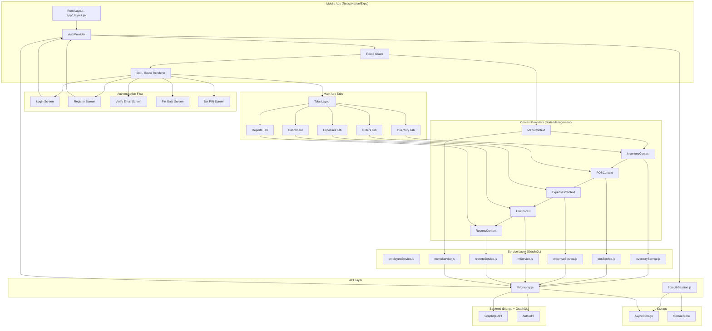
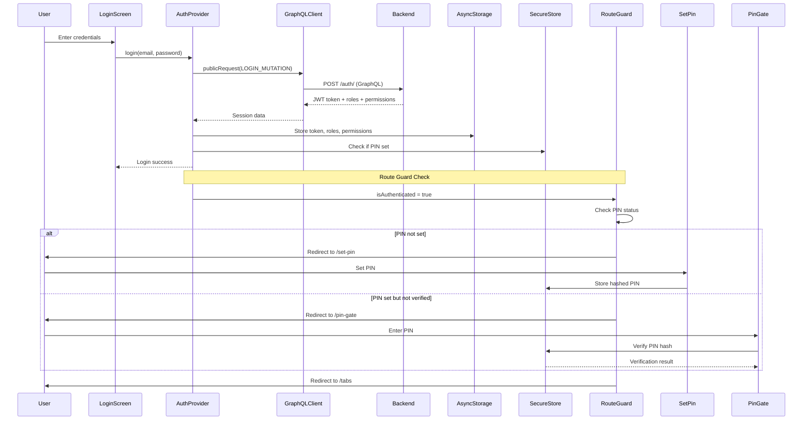
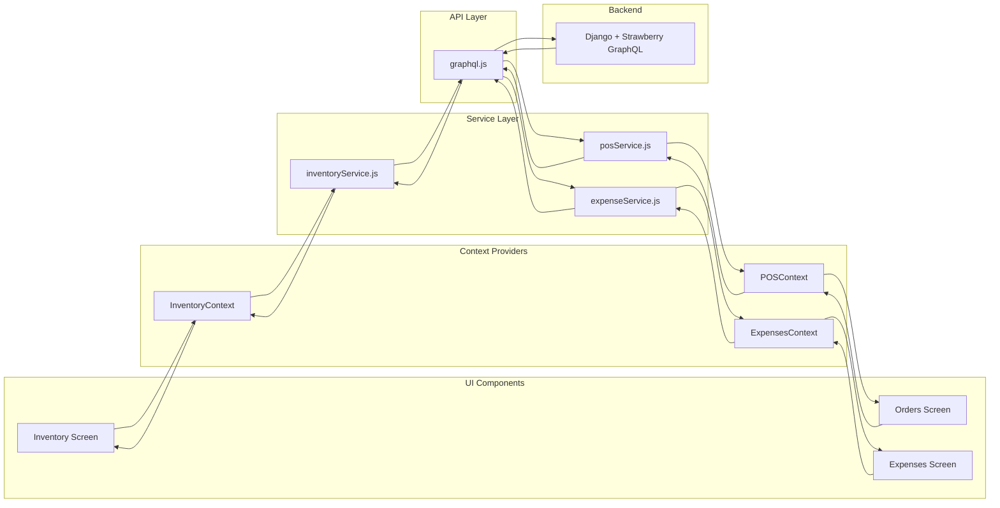
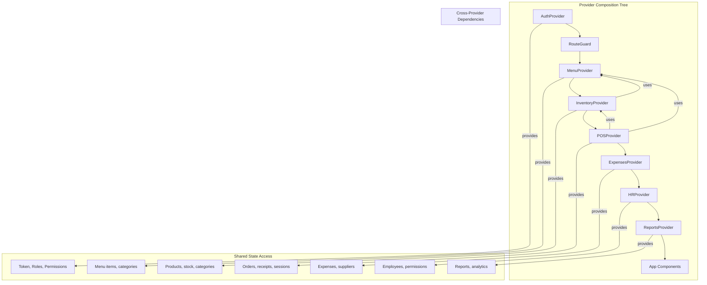

# Hotel Management System Architecture Diagram

## System Overview
This is a React Native (Expo) mobile application for managing hotel/restaurant businesses with a Django + Strawberry GraphQL backend.



## Authentication Flow Diagram



## Data Flow Architecture



## Provider Hierarchy & Data Flow



## Key Architecture Patterns

### 1. **File-Based Routing (Expo Router)**
- `app/_layout.jsx` - Root layout with route guard
- `app/(auth)/` - Authentication screens group
- `app/(tabs)/` - Main tab navigation group
- Automatic route protection based on auth state

### 2. **Context-Based State Management**
- Modular providers for each domain (Auth, Inventory, POS, etc.)
- Provider composition tree for dependency injection
- Centralized state management with React hooks

### 3. **Service Layer Pattern**
- Separation of UI logic from API calls
- GraphQL services in `services/` directory
- Normalized data responses from backend
- Centralized error handling

### 4. **Authentication & Security**
- JWT-based authentication with Django backend
- Role-based access control (RBAC)
- PIN gate for device-level security
- Secure storage for sensitive data (SecureStore)
- Session persistence with AsyncStorage

### 5. **API Communication**
- Custom GraphQL client (`lib/graphql.js`)
- Automatic token injection in requests
- Environment-based API endpoint configuration
- Centralized error handling with auth failure detection

## Technology Stack

**Frontend:**
- React Native 0.81.5
- Expo ~54.0.36
- Expo Router for navigation
- React Context API for state management
- AsyncStorage for session persistence
- Expo SecureStore for sensitive data

**Backend:**
- Django + Strawberry GraphQL
- JWT authentication
- Multi-tenant architecture (schema-based)
- Role-based access control

**Key Libraries:**
- `@react-navigation/native` - Navigation
- `@react-native-async-storage/async-storage` - Storage
- `expo-secure-store` - Secure storage
- `react-native-chart-kit` - Charts/reports
- `expo-haptics` - Haptic feedback

## File Structure

```
hotel-management/
├── app/
│   ├── (auth)/              # Authentication screens
│   │   ├── login.jsx
│   │   ├── register.jsx
│   │   ├── verify-email.jsx
│   │   └── _layout.jsx
│   ├── (tabs)/              # Main tab navigation
│   │   ├── index.jsx        # Dashboard
│   │   ├── inventory.jsx
│   │   ├── orders.jsx
│   │   ├── expenses.jsx
│   │   ├── reports.jsx
│   │   └── _layout.jsx
│   ├── _layout.jsx          # Root layout + route guard
│   ├── pin-gate.jsx         # PIN verification
│   └── set-pin.jsx          # PIN setup
├── context/                 # State management providers
│   ├── AuthContext.jsx
│   ├── InventoryContext.jsx
│   ├── POSContext.jsx
│   ├── ExpensesContext.jsx
│   ├── HRContext.jsx
│   ├── ReportsContext.jsx
│   └── MenuContext.jsx
├── services/                # GraphQL service layer
│   ├── employeeService.js
│   ├── expenseService.js
│   ├── hrService.js
│   ├── inventoryService.js
│   ├── menuService.js
│   ├── posService.js
│   └── reportsService.js
├── lib/                     # Core utilities
│   ├── graphql.js          # GraphQL client
│   └── authSession.js      # Auth session management
├── components/             # Reusable UI components
│   ├── Expenses/
│   ├── HR/
│   ├── Inventory/
│   ├── POS/
│   └── Reports/
└── hooks/                  # Custom React hooks
    └── useTheme.js
```

## Data Flow Summary

1. **User Authentication**: Login → JWT token → AsyncStorage → Route Guard → Main App
2. **PIN Security**: Session active → PIN check → SecureStore verification → App access
3. **Data Loading**: Component → Context Provider → Service → GraphQL → Backend
4. **State Updates**: Backend response → Service normalization → Context update → UI re-render
5. **Cross-Domain**: POS uses Inventory data, Inventory uses Menu data (provider dependencies)

## Security Features

- JWT token-based authentication
- Role-based access control (RBAC)
- PIN gate with lockout after failed attempts
- Secure storage for PIN hashes
- Automatic session cleanup on auth failure
- Environment-based API endpoint configuration
